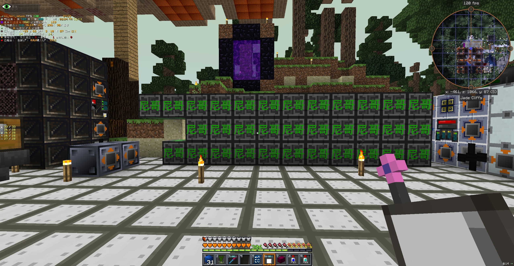
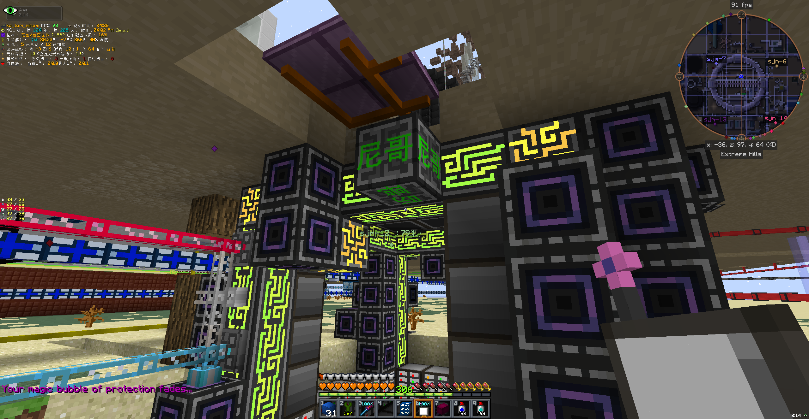

# GTNH 赛博尼哥监控手机端

在手机上监控 GTNH 服务器里的 AE 网络和合成 CPU —— 看谁在偷懒，顺手把活派下去。

需要服主在服务器上装 [AEMobile](https://github.com/Huaxidesu/AEMobile) 这个 mod（提供手机端连的 TCP 服务）。

---

## 一、装什么

1. 服主装好 mod，在 ME 控制器旁边放下「AE 监控器」方块，聊天栏会给你一串访问密码
2. 装这个 App
3. **首次打开**会停在「首次使用」页：
   - 有服主给的配置包（`.zip`）→ 点「选择配置文件」导入
   - 没有 → 手动填**服务器地址**（不带端口）和**密码**，再填**图标源地址**（服主提供）

> App 不内置图标库，也没有预设服务器 —— 图标是各模组的艺术作品，由服主自己搭更新源分发。

---

## 二、能干什么

- **物品终端**：按 mod / 数量 / 名称排序，可按「物品 / 流体 / 源质」分类筛选，也能只看可合成
- **搜索**：按显示名搜，流体和源质也能搜到
- **合成计划**：点物品 → 生成合成计划 → 自动分配到空闲 CPU，材料缺失会标出来
- **CPU 监控**：每台 CPU 的进度、剩余时间、任务明细
- **多账号 / 多线路**：一个 App 存多个服务器，随时切
- **离线缓存**：断线也能翻上次拉到的数据

---

## 三、图标库

物品图标（6 万多个）、流体名、神秘时代源质图标分成三个库，**分开更新**：
设置 → 图标库 → 检查更新，只下载变化的那一个。

- 想自己搭更新源 / 导出图标 / 做内置图标的安装包：见 [AEMobileIcoOutput](https://github.com/Huaxidesu/AEMobileIcoOutput)
- 游戏里导出图标的指令：`/aemobile dumpicons`（客户端指令，进世界后敲）

---

## 四、其它

- 需要 Android 8 以上；局域网/公网直连，走 mod 的 TCP 端口（默认 44444）
- 图标素材版权归各自模组作者所有（GregTech、Thaumcraft 及各 GTNH 模组）
