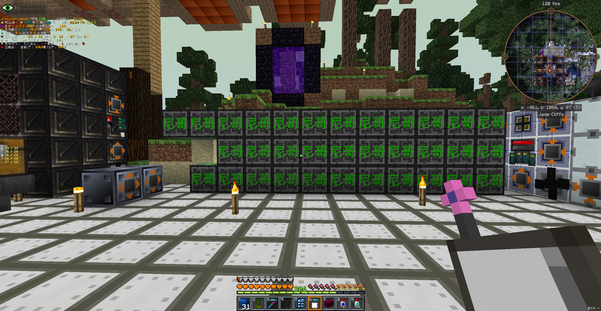
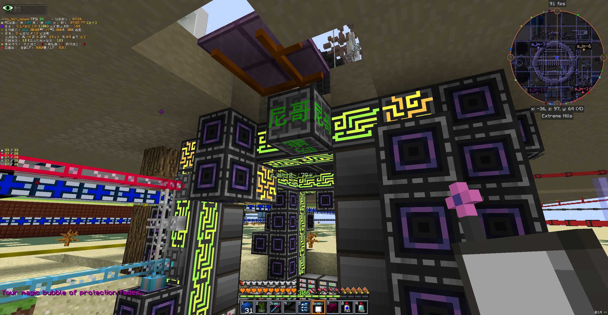

# GTNH 服务器 AE 监控手机端

| 仓库 | 是什么 |
|---|---|
| [AEMobile](https://github.com/Huaxidesu/AEMobile) | 服务端 mod：AE 监控器、TCP 服务、图标导出命令 |
| **[AEMobileApp](https://github.com/Huaxidesu/AEMobileApp)** | 手机端 App（本仓库）：AE 监控、物品 / 流体 / 源质终端 |
| [AEMobileIcoOutput](https://github.com/Huaxidesu/AEMobileIcoOutput) | 图标库维护包：导出、建库、出包脚本 |

在手机上监控 GTNH 服务器里的 AE 网络和合成 CPU，查看各玩家的活动并直接派发合成任务。

需要服主在服务器上安装 [AEMobile](https://github.com/Huaxidesu/AEMobile) 这个 mod（提供手机端连接的 TCP 服务）。

---

## 安装

1. 服主安装好 mod，在 ME 控制器旁边放置「AE 监控器」方块，聊天栏会显示一串访问密码
2. 安装本 App
3. **首次打开**时停留在「首次使用」页：
   - 有服主提供的配置包（`.zip`）→ 点「选择配置文件」导入
   - 没有 → 手动填**服务器地址**（不带端口）和**密码**，再填**图标源地址**（服主提供）
   - 如仅需使用公屏聊天：填好地址后点 **「仅使用聊天功能」**，无需绑定码，也无需选择主网
     （需要服务端启用 `[chat] guest=true`，可收发聊天、没有物品/合成/监控；补上密码可随时解锁全部功能）

> App 不内置图标库，也没有预设服务器 —— 图标是各模组的艺术作品，由服主自行搭建更新源分发。

---

## 功能

- **物品终端**：按 mod / 数量 / 名称排序，可按「物品 / 流体 / 源质」分类筛选，也能只看可合成
- **搜索**：按显示名搜索，流体和源质同样可搜
- **合成计划**：点物品 → 生成合成计划 → 自动分配到空闲 CPU，材料缺失会标注
- **CPU 监控**：每台 CPU 的进度、剩余时间、任务明细
- **多账号 / 多线路**：一个 App 保存多个服务器，随时切换
- **离线缓存**：断线时仍可查看上次获取的数据

---

## 图标库

物品图标（6 万多个）、流体名、神秘时代源质图标分成三个库，**分开更新**：
设置 → 图标库 → 检查更新，只下载有变化的那一个。

- 如需自建更新源 / 导出图标 / 制作内置图标安装包：见 [AEMobileIcoOutput](https://github.com/Huaxidesu/AEMobileIcoOutput)
- 游戏内导出图标的指令：`/aemobileicons dump all`（客户端指令，进入世界后执行；也可只导出其中一类，见该仓库文档）

---

## 其它

- 需要 Android 8 以上；局域网/公网直连，走 mod 的 TCP 端口（默认 44444）
